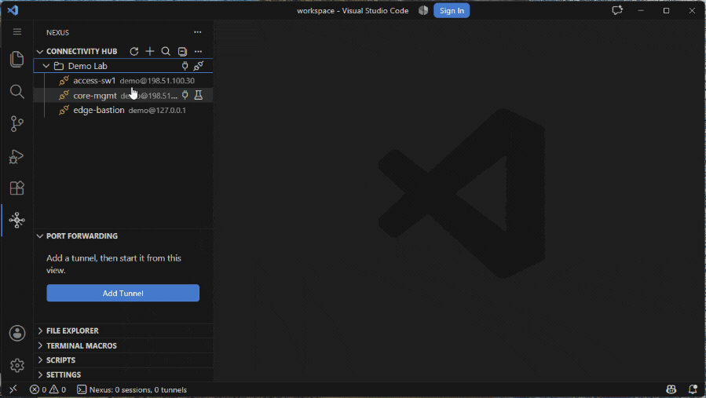

# SSH and Telnet

Connect to remote servers over SSH from the Connectivity Hub, or set a server to raw telnet for console servers, virtual-lab consoles, and gear that offers nothing else.

**Unlike Remote-SSH, nothing is installed on the remote.** It's a pure client: no `vscode-server` unpacked into the target, no node process running on the far end. That matters when the far end is a Cisco switch, a bastion you only get a shell on, or a change-controlled box where you can't drop an agent.

## Add a Server

1. Click `+` (**Add Profile**) in the Connectivity Hub title bar and keep **Network Device Profile** as the profile type, or run `Nexus: Add Network Device Profile (SSH / Telnet)` from the command palette
2. Enter host, port, username, and authentication details (password, private key, or SSH agent)
3. Optionally configure a proxy (SSH jump host, SOCKS5, or HTTP CONNECT) under the Proxy section — see [Jump Hosts and Proxies](#jump-hosts-and-proxies)
4. Right-click the server and select **Connect** to open a terminal session
5. To set up key-based auth: right-click the server → **Deploy SSH Key** → select or generate a key → the public key is deployed automatically — see [Deploy an SSH Key](#deploy-an-ssh-key)

## Authentication

Connect to remote servers with password, private key, or SSH agent authentication.

Two-factor authentication (keyboard-interactive) is fully supported — passwords auto-fill while verification codes are prompted separately.

Credentials are cached securely via VS Code SecretStorage with silent re-auth.

When several SSH logins need input at once, server password, proxy password, key passphrase, and verification-code prompts appear one at a time. Logins that need the same credential can share one answer; prompts for different credentials wait their turn. Canceling a shared proxy-password prompt stops every waiting login before the proxy handshake; a later connection asks again. A queued prompt is discarded if its server changes before it opens or its terminal closes; a prompt shared with another open terminal remains available to that terminal. A timed-out connection drops its queued verification prompt. If a saved password or passphrase fails, Nexus clears it only if the saved value is still the one that failed, so a newer saved answer is kept. A saved password is cleared only when the server rejects it, and a saved key passphrase only when it fails to decrypt the key (the server never sees it). A login that ends without either verdict — a connection that closed mid-login, a terminal closed or reconnected while connecting, or a dismissed verification-code prompt — keeps both.

If the last connection waiting on an open server-password, proxy-password, or key-passphrase dialog closes, Nexus dismisses that dialog so another connection can prompt. A shared dialog stays open while another connection still needs it.

### SSH agents: Pageant and OpenSSH

A server or auth profile set to **SSH Agent** signs in with a key held by an SSH agent — and so does a server synced from an inventory source without an auth profile. Which agent is one choice for the machine, not a field of each server: **SSH Agent** in the Nexus Settings panel's SSH section (`nexus.ssh.agent`). It applies to terminals, SFTP, tunnels and jump hosts alike, and a change takes effect at the next connection.

With **Automatic** (the default), Nexus looks for the agent on every connection, in this order:

1. `SSH_AUTH_SOCK`, when VS Code was started with it — on any operating system.
2. On Windows, PuTTY's **Pageant** (0.75 or newer), found by the named pipe it opens for your Windows user. The pipe's name can change when Windows restarts, which is why Nexus finds it each time instead of asking you to enter it.
3. On Windows, the OpenSSH agent pipe (`\\.\pipe\openssh-ssh-agent`) — the **OpenSSH Authentication Agent** service, or another agent that provides that pipe, such as 1Password.

Nexus only uses a Pageant pipe named for your Windows user name. For some domain, Microsoft and Entra accounts Pageant names its pipe after another form of your name; Nexus then does not use it and names the pipe it found — in the error, or, when it uses the OpenSSH agent pipe instead, in the **Nexus SSH** output channel. If that Pageant is yours, choose **Custom socket or pipe** and enter that pipe (its name can change when Windows restarts).

When both Windows agents are running, Pageant is used; choose **OpenSSH Agent (Windows)** to use the other one. **Pageant (Windows)** and **OpenSSH Agent (Windows)** use only that agent and never fall back to another — they also ignore `SSH_AUTH_SOCK`. **Custom socket or pipe** uses the path in **Agent Socket or Pipe** (`nexus.ssh.agentPath`).

On Windows `SSH_AUTH_SOCK` is often set for the whole user, for example to `\\.\pipe\openssh-ssh-agent`. If the agent it points to is not running, Automatic stops there rather than quietly using another agent: start that agent, choose the agent to use instead (such as **Pageant (Windows)**), or remove `SSH_AUTH_SOCK` from the Windows environment and fully restart VS Code so Automatic can find Pageant or the OpenSSH agent itself.

On Linux and macOS, Automatic uses `SSH_AUTH_SOCK` only. VS Code started from a desktop launcher often does not have it: start VS Code from a shell where your agent runs, or choose Custom and enter the agent's full socket path. PuTTY's Pageant on Linux opens a differently named socket each time it starts; run it as `pageant --symlink <fixed path>` and enter that fixed path.

Before connecting, Nexus asks the agent which keys it holds. If the agent cannot be reached, or does not answer within 5 seconds, the connection stops there with the agent's path and what to do. If no agent is found, or the agent holds no keys (or is locked), the login carries on with whatever else the server offers — on many network devices a keyboard-interactive password prompt, exactly as before. If the server then refuses the login before you have typed anything, the error names the missing agent and the fix; a password or code you typed that the server refuses is reported as a rejected login, as it always was, with a note that no agent key was offered. A terminal's error offers **Open Agent Settings** and **Edit Server**, and Test Connection offers **Open Agent Settings**. The agent each login used, and why, is written to the **Nexus SSH** output channel.

Both settings are machine-specific: a workspace's `.vscode/settings.json` cannot set them and Export for Sharing leaves them out, so neither a repository you open nor a file someone sends you can redirect your key signing to another agent.

### Deploy an SSH Key

Right-click any server and select "Deploy SSH Key" to automate key-based authentication setup. Discovers existing local keys or generates new ed25519 key pairs, deploys the public key to the remote `authorized_keys`, and optionally converts the server profile to key auth. Cross-platform (Windows, macOS, Linux).

### Host Key Verification

Trust-on-first-use (TOFU) model stores host keys on first connection and alerts if a key changes (potential MITM). Configurable via `nexus.ssh.trustNewHosts`.

## Auth Profiles

Define reusable credential sets (password, private key, or SSH agent) and apply them to individual servers or entire folders in bulk.

A NetBox or Proxmox [inventory source](inventory/README.md) can carry a profile too, so every SSH server it syncs connects with those credentials from the start. (The field is on every source's form, but EVE-NG and GNS3 nodes sync as [telnet](#telnet) consoles, which have no login for it to fill.)

The link is a reference, not a copy — edit the profile once and every server using it picks up the change, no re-sync needed.

A failed login on one linked server never erases the profile's saved credential — one broken device can't lock the rest of the fleet out of silent re-auth; the stored credential is only replaced when a device actually signs in with a new one.

Manage profiles from a dedicated editor panel accessible via the Settings tree or context menu.

## Jump Hosts and Proxies

Route SSH connections through intermediaries when direct access isn't available.

### Reaching a Device Two Hops Away

Jump hosts are set per server, and a jump host can have a jump host of its own — so the chain goes as deep as your network does. Below, an access switch is reached through an NMS host, which is itself reached through a bastion. One connect walks the chain, authenticating each hop in turn, and the shell lands on the switch. No `ProxyJump` stanza to hand-write, and nothing installed on any host along the way.

### Proxy Types

Three proxy types are supported per server:

- **SSH Jump Host** — Select another configured server as a bastion/jump host (ProxyJump equivalent). Supports multi-hop chaining (A → B → C) with full auth reuse.
- **SOCKS5 Proxy** — Connect through a SOCKS5 proxy server with optional username/password authentication.
- **HTTP CONNECT Proxy** — Connect through an HTTP proxy using the CONNECT method, common in corporate environments.

### Connect Through a Proxy

If your target server is behind a firewall or bastion host:

1. **SSH Jump Host** — First add the bastion server as a regular server profile, then edit the target server and set its proxy to "SSH Jump Host", selecting the bastion from the dropdown. Multi-hop chains (A → B → C) work automatically.
2. **SOCKS5 / HTTP CONNECT** — Edit the target server and set its proxy type, entering the proxy host, port, and optional credentials. Proxy passwords are stored securely in VS Code SecretStorage, one per proxy (type, host, port and user name): changing the proxy stops the old password from being used, and switching back to a proxy finds its saved password again until you save a change that leaves it.

## Alternate Host

A server can hold a second SSH address in its **Alternate host** field (Advanced section of the server form) — typically the IPv6 to its IPv4, or the reverse.

When a terminal can't reach the primary Host at the connection level (no route, connection refused, a connect timeout before the TCP socket opens, or a name that won't resolve), Nexus retries once against the alternate and the terminal banner names the address that won.

It falls back only on those transport-level failures — an authentication, host-key, key, or proxy failure is never retried on the other address, since it would fail there too and could cost a second credential prompt. A handshake that times out after the socket has connected is not retried either — the host is reachable, so the alternate would not help.

One caveat: a password-auth server with no saved password is asked for the password before each attempt, so a fallback can prompt twice — saving the password (or using a key or agent) avoids it.

Only the terminal's own connect attempt tries the alternate. A tunnel, SFTP session or jump-host hop that opens its own connection always dials the primary Host — though with [connection multiplexing](#connection-multiplexing) on (the default), one that shares the terminal's existing connection rides whichever address that connection reached.

From NetBox, this fills itself in — see [Primary IP Family and Alternate Host](inventory/netbox.md#primary-ip-family-and-alternate-host). A [Proxmox](inventory/proxmox.md) source fills it in the same way when a guest's network card carries both families.

## Legacy Devices

A per-server legacy algorithm toggle is there for older devices (Cisco IOS, embedded systems) — including devices that only speak the 1024-bit `diffie-hellman-group1-sha1` key exchange, which VS Code's Electron crypto otherwise refuses to build ("Unknown DH group"). Together with multi-hop jump-host chaining (A → B → C), this per-server legacy KEX/cipher toggle keeps you connected to old IOS boxes that modern clients refuse.

## Connection Multiplexing

Share SSH connections across terminals, tunnels (in their default shared mode), and SFTP for the same server. A jump host's connection is shared the same way by everything routed through it, isolated-mode tunnels included, unless multiplexing is off for the jump host. Reduces connection overhead with automatic ref-counting and configurable idle timeout.

Editing a jump host's connection settings (or its auth profile), or removing the jump host (or refreshing after another window saved a change), also retires the shared connections of the servers that go through it. Sessions already open keep running on their old connection; the next reconnect or tunnel start builds a new one over the current route.

Per-server toggle lets you disable multiplexing for devices that don't support multiple channels (e.g. Cisco).

Automatic fallback to standalone connections handles channel failures transparently.

## If the Server Changes While Connecting

If the server is removed or its connection settings (address, port, protocol, user name, authentication method, key file, auth profile link, proxy or jump host) change before the terminal opens (the user name, authentication method and key file count as they end up after the linked auth profile is applied, and a jump host's own connection settings count too), Nexus cancels the connect and shows a notice, with **Retry** on the current settings when the server still exists (it repeats the original action, such as Connect and Run Script). Saving the server without changes, renaming its folder, or refreshing after another window saved, does not cancel it. This applies to SSH and Telnet, and the check happens once, just before the terminal is created. Once the terminal is open — including while it waits for a password or verification code, or for the Telnet connection — the session keeps the settings it started with, and an edit applies at the next connect. These checks compare the saved configuration; a saved password, key passphrase or proxy password changed in the secret store does not cancel a pending start, and the new value is used at the next login.

## When a Session Drops

Faults that arrive *after* a session is up — a keepalive timeout, a protocol error, the connection closing — are recorded in the **Nexus SSH** output channel, so a terminal that drops on its own leaves a cause behind instead of only "Connection lost".

When an SSH session drops, Nexus disables terminal mouse-tracking, focus-reporting, color-scheme notification, alternate-scroll, bracketed-paste, application-cursor-key and application-keypad modes, shows the cursor, and resets the active screen's Kitty keyboard-mode stack and flags before showing the disconnect banner. Telnet, Serial and Smart Follow terminals get the same reset, and a disconnected Telnet or Serial tab closes only on a real key press, not on focus, mouse or color-scheme reports or up/down arrow sequences (wheel scrolling). Press **R** to reconnect an SSH session in the same tab; your visible output and scrollback stay available, and late output from the old connection is ignored even after reconnect.

## Telnet

Set a server's **Protocol** to *Telnet* and it connects over raw telnet instead of SSH, for console servers, virtual-lab consoles, and gear that offers nothing else.

It is a per-server switch on the profile you already have, not a separate kind of profile: pick Telnet and the credential fields disappear, because telnet has no login of its own — you authenticate at the device's own prompt, in the terminal.

Nexus speaks the negotiation properly (echo and suppress-go-ahead, terminal type, and live window-size updates on resize), so full-screen tools and line editing behave.

Everything the terminal layer gives an SSH tab it gives a telnet tab too: [highlighting](terminal.md#highlighting), [Reset / Clear Scrollback / Copy All](terminal.md#tab-commands), [auto-trigger macros](macros.md), and [scripts](scripting.md) (`@target-type telnet`).

**Telnet is cleartext** — there is no encryption and no authentication in the protocol — so SFTP, port forwarding, jump hosts and key deployment aren't available on a telnet server, and asking for one says so up front instead of failing inside a handshake.

## Related settings

SSH connection, SSH agent, keepalive, host-key, proxy-timeout and multiplexing settings: [settings.md#ssh](settings.md#ssh).

## See also

- [Port Forwarding](port-forwarding.md) — TCP tunnels through an SSH server
- [File Explorer](file-explorer.md) — SFTP browsing on a connected server
- [Terminal](terminal.md) — highlighting, tab commands, transcripts, keyboard passthrough
- [Import and Export](import-export.md#import-from-an-ssh-config) — bring servers in from `~/.ssh/config`, MobaXterm or SecureCRT
- [Inventory Sync](inventory/README.md) — servers created from NetBox, EVE-NG, Proxmox, GNS3 or Containerlab, including [servers with no address yet](inventory/README.md#servers-with-no-address-yet)
- [Connectivity Hub](connectivity-hub.md) — folders, filter and drag and drop
